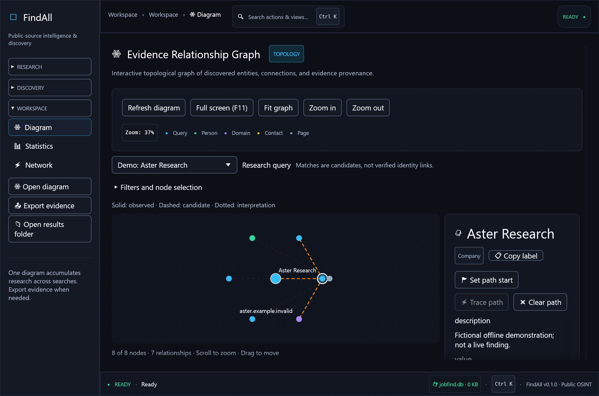
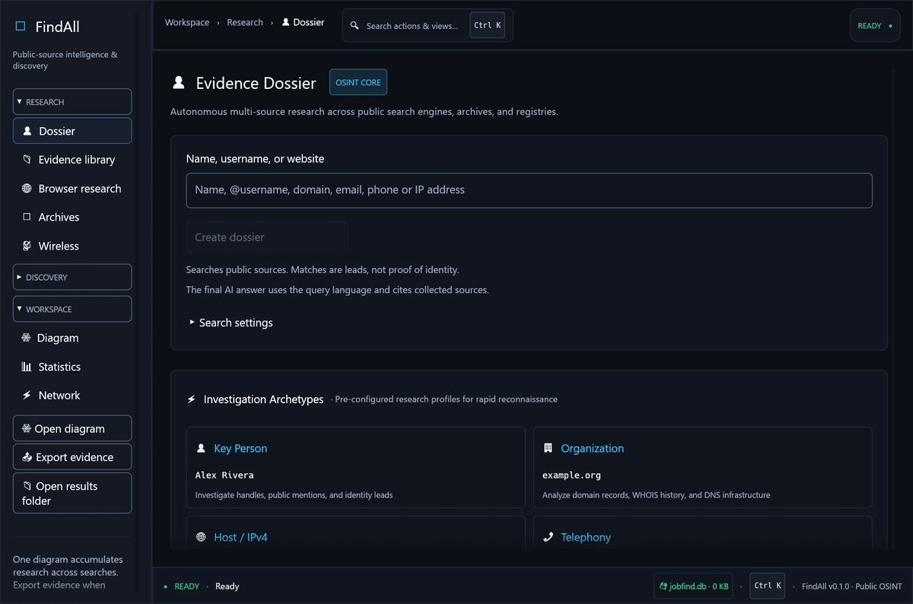
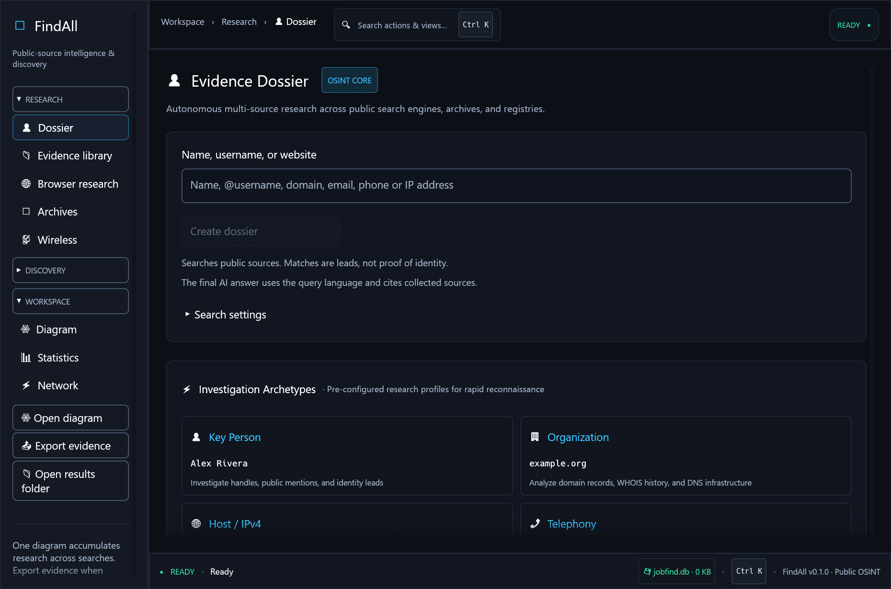
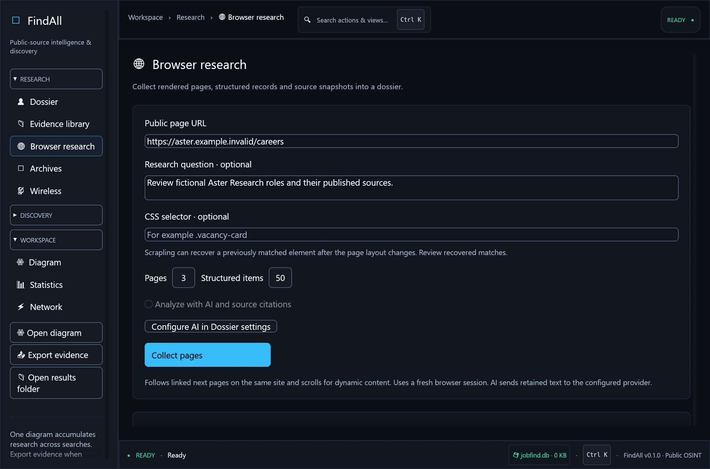
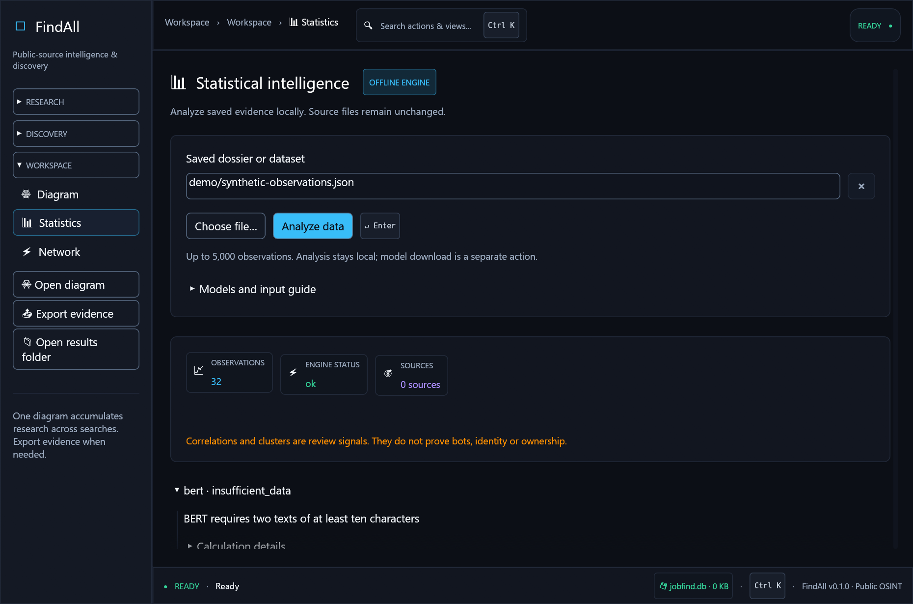

# FindAll

Windows desktop workspace for public-source research, job discovery and local
evidence analysis. Python collectors and a native Rust/egui interface keep source
links, observation times and exported reports together.



## Interface tour



Real native application screens, rendered with fictional offline data. The GIF
cycles through screen captures; it is not a recording of a live investigation.
No external website or AI provider was queried for these illustrations.

<details>
<summary>View individual screenshots</summary>

### Create a dossier



### Browser research



### Local statistics



</details>

## Capabilities

- Research people, organizations, domains and public accounts with bounded collectors.
- Build dossiers with a source ledger, JSON/CSV/Markdown exports and one relationship diagram.
- Collect browser evidence and import selected documents into a local evidence library.
- Analyze explicit CSV/JSON inputs with local statistical and geographical methods.
- Use optional AI providers for answers linked to collected evidence.

Matching names, accounts or infrastructure remain candidates. External sources can
block requests, require credentials or return partial results; these states are
retained in reports. AI analysis sends selected evidence to the configured provider.

## Requirements

- Windows 10/11, Python 3.10 or newer, and Git.
- Rust 1.95 or newer with MSVC build tools for the native interface.
- Go 1.23 or newer for the PhoneInfoga bridge installed by `setup.bat`.
- Node.js 22.12 or newer for optional Web-Check.

The repository contains source. Executables, Python environments, models, account
sessions and research results are installed or created locally.

## Quick start

Run in PowerShell from a fresh checkout's root:

```powershell
cd jobfind
.\setup.bat
Copy-Item osint-keys.env.example osint-keys.env
Copy-Item profile.example.json profile.json
cd ..
.\start.bat
```

Keep existing local configuration files when updating. Leave unused API keys empty.
`setup.bat` installs Python requirements, pinned research tools and the PhoneInfoga
bridge. It downloads dependencies without signing in to external accounts. The
first UI launch builds the Rust application and downloads missing Cargo packages.

CLI usage without building the UI:

```powershell
.\jobfind\.venv\Scripts\python.exe .\jobfind\jobfind.py --help
```

Additional setup from `jobfind/`:

| Feature | Command |
| --- | --- |
| Rendered browser collection | `.venv\Scripts\python.exe -m playwright install chromium` |
| Web-Check | `.\setup-webcheck.bat` |
| Local model weights | `.\setup-analysis.bat` |
| PDF OCR and semantic evidence library | `.\setup-library.bat` |
| Tor | `.\setup-tor.ps1` |
| Wireless adapters | `.\setup-wireless.bat` |

Blackbird and TikTok Scraper snapshots are excluded because their local checkouts
lack complete license files. Their optional adapters remain in FindAll and report
missing tools. Downloaded executables such as Amass, httpx and Subfinder are also
excluded. See [third-party notices](THIRD_PARTY_NOTICES.md).

## Development

```powershell
cd jobfind
.\test.bat
```

GitHub CI runs Python regression checks and Rust tests on Windows. Browser
packages, models, authenticated providers and hardware checks need their own setup.

| Path | Contents |
| --- | --- |
| `jobfind/jf/` | Collectors, evidence processing and exports |
| `jobfind/jobfind.py` | Python CLI |
| `jobfind/rust-ui/` | Native interface and Cargo lockfile |
| `jobfind/tests/` | Regression tests |
| `jobfind/examples/` | Synthetic statistics datasets |
| `jobfind/docs/` | Technical documentation and dated verification reports |
| `jobfind/third_party/` | Selected source snapshots with upstream notices |

Detailed commands: [application guide](jobfind/README.md).
Contributing: [CONTRIBUTING.md](CONTRIBUTING.md).
Private data and vulnerability reporting: [SECURITY.md](SECURITY.md).

## Publication and local data

Use the [publication guide](docs/GITHUB_PUBLICATION.md) to create a separate clean
repository from a populated workspace. Databases, `jobfind_out/`, `network/`,
profiles and credentials stay in the working installation. The desktop application
uses `jobfind.db` and `jobfind_out/` in the parent workspace; CLI relative paths
depend on its working directory. Existing archives and backups are preserved.

## Licensing

No overall license for original FindAll code has been selected. Upstream
components retain their own terms. Chrome Crawler and WireTapper have
non-commercial restrictions; see [THIRD_PARTY_NOTICES.md](THIRD_PARTY_NOTICES.md).
